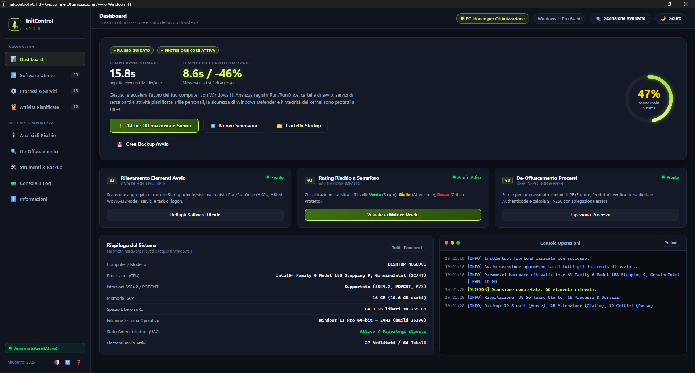
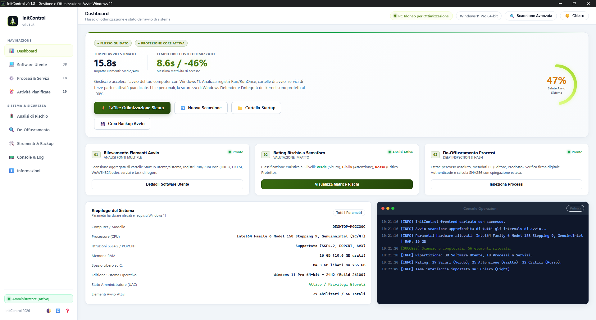

<div align="center">

# 🚀 InitControl

### **Windows 11 Startup Optimizer & Internals Manager**
*Gestione avanzata, analisi di sicurezza e de-offuscamento dei programmi in esecuzione automatica*

<!-- TECH_BADGES_START -->
[-0078D4?logo=windows&logoColor=white)](https://github.com/AngoloInformatico)
[](versione.json)
[](LICENSE)
[](Manifesto.md)
<br/>
[](https://www.python.org/)
[](https://flask.palletsprojects.com/)
[](https://pywebview.flowrl.com/)
[](https://github.com/giampaolo/psutil)
[](https://github.com/erocarrera/pefile)
[](https://python-pillow.org/)
[](https://www.pyinstaller.org/)
<!-- TECH_BADGES_END -->

<br/>

<p align="center">
  <b>🌙 Tema Scuro (Dark Obsidian)</b><br/>
  
</p>

<br/>

<p align="center">
  <b>☀️ Tema Chiaro (Light Mica)</b><br/>
  
</p>

</div>

---

## 📌 Indice
- [Cos'è InitControl](#-cosè-initcontrol)
- [Il Manifesto di InitControl](#-il-manifesto-di-initcontrol)
- [Perché InitControl (Oltre il Task Manager)](#-perché-initcontrol-oltre-il-task-manager)
- [Funzionalità Principali](#-funzionalità-principali)
- [Architettura e Tecnologie](#-architettura-e-tecnologie)
- [Struttura del Progetto](#-struttura-del-progetto)
- [Installazione e Avvio dai Sorgenti](#-installazione-e-avvio-dai-sorgenti)
- [Compilazione Eseguibile Standalone (.exe)](#-compilazione-eseguibile-standalone-exe)
- [Gestione della Versione](#-gestione-della-versione)
- [Autore e Canali Ufficiali](#-autore-e-canali-ufficiali)
- [Licenza](#-licenza)

---

## 🌟 Cos'è InitControl

**InitControl** è un'applicazione moderna per **Windows 11** dedicata all'analisi approfondita, alla verifica di sicurezza e all'ottimizzazione trasparente dell'avvio del sistema operativo. 

A differenza del classico *Gestione Attività* (Task Manager) di Windows, che mostra solo una frazione superficiale dei software attivi al logon, InitControl aggrega e analizza **tutti i punti di persistenza nativi del sistema operativo**, inclusi i nodi di registro a 32 e 64 bit, le cartelle Startup, i servizi terze parti e i task pianificati di Windows.

L'interfaccia adotta un design ricercato con supporto nativo al **doppio tema Scuro (Dark Obsidian) e Chiaro (Light Mica)** con accenti ad alta visibilità **Cyber Electric Lime (`#D4F86A` / `rgb(212, 248, 106)`)**, micro-animazioni fluide, tachimetro SVG radiale con calcolo in tempo reale del boot impact e console terminale integrata in stile macOS. Lo switch tema è memorizzato automaticamente nelle preferenze locali.

---

## 📜 Il Manifesto di InitControl

> [!TIP]
> ### 📖 Scopri la Filosofia e l'Architettura Completa
> Per una comparazione approfondita e per comprendere i principi di sovranità dell'utente, de-offuscamento PE e superamento dei vincoli dei pacchetti moderni di Windows:  
> 👉 **[Leggi il Manifesto di InitControl (Manifesto.md)](Manifesto.md)**

---

## ⚡ Perché InitControl (Oltre il Task Manager)

| Funzionalità | Gestione Attività (Task Manager) | InitControl |
| :--- | :---: | :---: |
| **Copertura Persistenza** | Solo Run base utente | Registro 32/64 bit, Startup Folders, Servizi terze parti, Task Pianificati |
| **Classificazione di Rischio** | Assente | **Semaforo a 3 livelli** (🟢 Sicuro, 🟡 Attenzione, 🔴 Critico) |
| **Protezione Componenti Core** | Nessun avviso di sicurezza | **Kernel Guard con doppia conferma** per prevenire crash |
| **Ispezione Dettagliata Binari** | Solo nome file | **De-offuscamento PE**, Editore, Firma Authenticode, SHA256 |
| **Ottimizzazione 1-Click** | Assente (manuale item per item) | **Algoritmo euristico Safe 1-Click** con backup automatico |
| **Punti di Ripristino Snapshot** | Nessuno | **Backup & Rollback istantaneo** in 1 clic di tutte le chiavi modificate |
| **Velocità di Scansione** | Lenta / Parziale | **Multi-thread ultra rapido (< 4.5 secondi)** |

---

## 🛠️ Funzionalità Principali

### 1. Scansione Approfondita e Aggregata
InitControl scansiona contemporaneamente:
- **Registro HKCU**: `SOFTWARE\Microsoft\Windows\CurrentVersion\Run` e `RunOnce`
- **Registro HKLM**: `SOFTWARE\Microsoft\Windows\CurrentVersion\Run` e `RunOnce`
- **Registro WoW6432Node**: `SOFTWARE\WOW6432Node\Microsoft\Windows\CurrentVersion\Run` e `RunOnce`
- **Cartelle di Avvio (Startup Folders)**: Cartella utente (`%APPDATA%`) e globale (`%PROGRAMDATA%`) con risoluzione automatica dei file `.lnk` (collegamenti).
- **Servizi Terze Parti**: Isolamento dei servizi non-Microsoft con stato e tipo di avvio (Auto, Demand, Disabled).
- **Attività Pianificate**: Scansione dei Task di Windows che si innescano al Logon utente.

### 2. Rating a Semaforo & Protezione Kernel Guard
Ogni elemento viene valutato istantaneamente:
- 🟢 **VERDE (Safe)**: Applicazioni utente non essenziali (es. Spotify, Discord, Steam, Telegram, client cloud). Disabilitabili per velocizzare l'avvio senza rischi.
- 🟡 **GIALLO (Caution)**: Utility hardware, driver grafici, suite audio (es. Realtek Audio Console, pannelli NVIDIA/AMD/Intel).
- 🔴 **ROSSO (Critical)**: Componenti critici di sistema (Windows Security Health, Defender, smart card, runtime essenziali). **Kernel Guard richiede una conferma esplicita per proteggere l'integrità del PC**.

### 3. De-Offuscamento PE & Analisi Approfondita
Il modulo di de-offuscamento analizza i file eseguibili (`.exe`, `.dll`) tramite parsing strutturato degli header PE:
- **Estrazione Metadati**: Nome Prodotto, Descrizione File, Versione Interna, Nome Originale.
- **Verifica Firma Digitale Authenticode**: Controllo della firma di sicurezza e identificazione dell'Editore verificato.
- **Calcolo Hash SHA256**: Generazione immediata dell'impronta crittografica per controlli di integrità e reputazione.
- **Valutazione Euristica Intelligente**: Spiegazione dettagliata sul ruolo del processo nel sistema.

### 4. Ottimizzazione Sicura in 1-Click & Ripristino Istantaneo
- **Safe 1-Click Optimizer**: Disabilita in blocco gli elementi ad avvio automatico non essenziali (verdi) mantenendo inalterati driver e processi critici.
- **Snapshot Backup Automatico**: Prima di applicare qualsiasi modifica, viene salvato uno snapshot completo dello stato del registro (`StartupApproved`) con possibilità di ripristinare la configurazione in qualsiasi momento.

---

## 🏗️ Architettura e Tecnologie

<!-- TECH_TABLE_START -->
| Componente | Software / Libreria | Versione Attiva | Ruolo Tecnologico |
| :--- | :--- | :---: | :--- |
| **Sorgenti InitControl** | InitControl Core | `v0.1.8 (Build #9)` | Motore di scansione, classificazione ed euristica |
| **Linguaggio Base** | Python | `3.14.7` | Runtime ed elaborazione nativa Windows 64-bit |
| **Web Framework & API** | Flask | `3.0.2` | Server HTTP locale ad alte prestazioni e routing API |
| **Desktop Host GUI** | pywebview | `6.2.1` | Finestra desktop nativa accelerata GPU Edge WebView2 |
| **System Diagnostics** | psutil | `7.2.2` | Monitoraggio risorse hardware, RAM, disco e CPU |
| **Analisi Eseguibili** | pefile | `2024.8.26` | Ispezione binari PE, sezioni, metadati e firme |
| **Elaborazione Icone** | Pillow (PIL) | `12.3.0` | Generazione grafica e rendering icone multi-risoluzione |
| **Toolchain Compilazione**| PyInstaller | `6.22.3` | Bundling standalone PE64 con manifest UAC Administrator |
<!-- TECH_TABLE_END -->

- **Core Backend**: Python 3 con moduli nativi `winreg`, `ctypes`, `subprocess`, librerie specializzate `psutil` e `pefile`.
- **API & Routing**: Flask REST API locale ad alte prestazioni.
- **Frontend Grafico**: HTML5 semantico, Vanilla CSS3 (Custom Properties HSL/RGB, Glassmorphism, Micro-animations), JavaScript ES2024.
- **Desktop Window Host**: [pywebview](https://pywebview.flowrl.com/) basato su Microsoft Edge Chromium WebView2 (interfaccia nativa, GPU-accelerated, zero terminale console visibile).
- **Compilazione**: Script automatizzato `GeneraExe.py` con PyInstaller 64-bit `--windowed`, embedding automatico dell'icona e delle risorse di versione PE Windows.

---

## 📁 Struttura del Progetto

```plaintext
InitControl/
│
├── core/                           # Moduli Python del motore di analisi
│   ├── classifier.py               # Algoritmo di classificazione a semaforo
│   ├── database.py                 # Regole e whitelist/blacklist di sicurezza
│   ├── deobfuscator.py             # Parser PE, firme Authenticode e hash SHA256
│   ├── optimizer.py                # Gestione attivazione/disattivazione e snapshot
│   ├── scanner.py                  # Scansione multi-sorgente ad alte prestazioni
│   └── system_info.py              # Diagnostica hardware, CPU POPCNT e Windows 11
│
├── web/                            # Frontend Web Dashboard (HTML5/CSS3/JS)
│   ├── assets/                     # Grafiche vettoriali (logo.svg)
│   ├── css/
│   │   └── style.css               # Design system Dark Obsidian & Lime (#D4F86A)
│   ├── js/
│   │   └── app.js                  # Logica applicativa e chiamate REST API
│   └── index.html                  # Interfaccia grafica principale
│
├── Icona/                          # Icone ufficiali dell'applicazione
│   ├── icon.ico                    # Icona multi-risoluzione per Windows (16px -> 256px)
│   └── icon.png                    # Icona ad alta risoluzione (256x256)
│
├── ScreenShot/                     # Schermate dimostrative dell'applicazione
│   ├── Screenshot_Dark.png         # Anteprima Dashboard in Tema Scuro (Dark Obsidian)
│   └── Screenshot_Light.png        # Anteprima Dashboard in Tema Chiaro (Light Mica)
│
├── app.py                          # Entrypoint principale dell'applicazione
├── GeneraExe.py                    # Script di compilazione standalone per Windows (.exe)
├── make_icon.py                    # Generatore procedurale dell'icona ufficiale
├── version_manager.py              # Gestore del tracciamento versioni e hash sorgenti
├── versione.json                   # File unico di definizione versione e build
├── requirements.txt                # Dipendenze Python necessarie
├── LICENSE                         # Testo ufficiale licenza GNU GPLv3
└── README.md                       # Documentazione del progetto
```

---

## 🚀 Installazione e Avvio dai Sorgenti

### Prerequisiti
- **Sistema Operativo**: Windows 11 (oppure Windows 10 x64)
- **Python**: Versione 3.10 o successiva installata nel sistema

### Procedura di avvio
1. **Clona la repository**:
   ```bash
   git clone https://github.com/AngoloInformatico/InitControl.git
   cd InitControl
   ```

2. **Installa le dipendenze richieste**:
   ```bash
   pip install -r requirements.txt
   ```

3. **Avvia l'applicazione**:
   ```bash
   python app.py
   ```
   *L'applicazione aprirà automaticamente una finestra nativa desktop centrata sullo schermo con Microsoft Edge WebView2.*

---

## 📦 Compilazione Eseguibile Standalone (.exe)

Per generare l'eseguibile autonomo a 64-bit per Windows (senza installatore e senza finestra di terminale), esegui lo script dedicato:

```bash
python GeneraExe.py
```

### Caratteristiche del build process:
- **Pulizia preventiva**: Rimuove completamente la cartella `dist/` prima di ogni nuova compilazione.
- **File Unico**: Genera esclusivamente il file [`dist/InitControl.exe`](dist/InitControl.exe).
- **Nessuna console**: Compilato con flag `--windowed` / `--noconsole`.
- **Privilegi Amministratore (UAC)**: Compilato con flag `--uac-admin` e auto-elevazione `runas` all'avvio per accedere senza limitazioni alle chiavi di registro di sistema HKLM e ai Servizi.
- **Posizionamento perfetto**: All'avvio la finestra si posiziona automaticamente al centro dello schermo.
- **Metadati Windows PE integrati**: Facendo *Tasto destro -> Proprietà -> Dettagli* sull'eseguibile, la versione, il copyright e il nome del prodotto corrispondono esattamente a [`versione.json`](versione.json).

---

## 🏷️ Gestione della Versione

Il progetto adotta un sistema di versioning rigoroso guidato dal file [`versione.json`](versione.json):

```json
{
  "version": "0.1.4",
  "build": 5,
  "channel": "Release"
}
```

Il modulo `version_manager.py` calcola l'hash crittografico dei file sorgenti (`.py`, `.html`, `.css`, `.js`) e sincronizza i metadati sia nell'interfaccia utente che nelle proprietà PE del binario compilato.

---

## 👨‍💻 Autore e Canali Ufficiali

**Created by Alex Lignola**  
*© 2026 InitControl - All rights reserved.*

- 📺 **YouTube**: [Angolo Informatico (@AngoloInformatico)](https://www.youtube.com/@AngoloInformatico)
- 🐙 **GitHub Profilo**: [github.com/AngoloInformatico](https://github.com/AngoloInformatico)
- 📂 **Tutti i Progetti & Repository**: [github.com/AngoloInformatico?tab=repositories](https://github.com/AngoloInformatico?tab=repositories)

Iscriviti al canale YouTube e segui la pagina GitHub per nuovi aggiornamenti, tutorial e release software!

---

## 📄 Licenza

Questo software è distribuito sotto licenza **GNU General Public License v3.0 (GPLv3)**.  
Per tutti i dettagli legali, consulta il file [LICENSE](LICENSE).

```text
InitControl - Copyright (C) 2026 Alex Lignola
This program is free software: you can redistribute it and/or modify
it under the terms of the GNU General Public License as published by
the Free Software Foundation, either version 3 of the License, or
(at your option) any later version.
```
